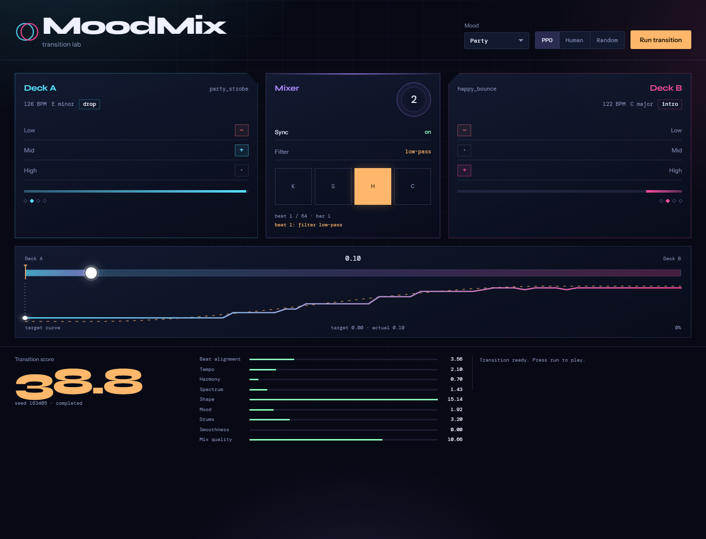

# MoodMix Env

A Gymnasium environment where an RL agent learns to **perform a DJ transition**,
not just pick a playlist. The agent works a physical-style control surface -
crossfader, three-band EQ per deck, tempo sync, a filter switch and four drum
pads - one beat at a time, and is scored on beat alignment, tempo, harmonic
compatibility, spectral separation, transition shape and mood.

The repo now includes the environment, a PPO training loop with checkpointing
and S3 sync, a browser controller, an evaluation harness against a hand-written
human baseline, and adapters for your own music library.



## Quickstart

```bash
pip install -e ".[demo]"
python scripts/make_demo_library.py     # writes data/demo/*.wav + manifest.json
python scripts/demo.py                  # terminal controller, human policy
python scripts/demo.py --audio          # ...and write runs/<mood>_demo.wav
python scripts/serve_demo.py            # browser controller on :8050
```

No audio hardware or network is needed. The six demo tracks are synthesised from
scratch with numpy, so the demo has no licensing baggage.

`--audio` renders the episode to a 30-second mono WAV using the same control
trace: equal-power crossfader, simple 3-band one-pole EQ, filter switch and
synthesized drum hits. It is for listening/evaluation, not a mastering chain.

## Train an agent

```bash
pip install -e ".[train]"
python scripts/train.py --timesteps 1000000 --n-envs 16 --vec-env subproc \
  --checkpoint-freq 50000 --output models/ppo_1m
```

- CPU is enough; the environment uses precomputed features.
- Laptop (12 threads): 100k ≈ 6 min, 1M ≈ 50-65 min.
- Checkpoints are written every `--checkpoint-freq` **environment** steps.
- Resume with `--resume checkpoints/ppo_moodmix_500000_steps.zip --timesteps 500000`.
  On resume, `--timesteps` is additional, not total.
- `--s3-uri s3://bucket/prefix` uploads checkpoints and the final model.
- `--device auto` picks CUDA if PyTorch has it; the tiny MLP is usually faster
  on CPU.

See [AWS.md](AWS.md) for instance sizing, spot-instance resume, TensorBoard and
SageMaker/EC2 commands, including the 100M-step trade-off.

## Evaluate against the human

```bash
python scripts/evaluate.py --model models/ppo_1m.zip --episodes 20
# add --reward-profile curve to score with the old reward
```

It runs PPO, the hand-written DJ and random on the same seeds and reports reward,
completion, final fader, mean deviation from the target curve and sync rate.

The reward numbers below are the `curve` profile, where following the authored
envelope is the objective: a 300,352-step checkpoint scores **+41.09 against the
human's +39.18** over 10 seeds, with 100% completion and a curve error of 0.056.
Under `expressive` the ordering flips - a model trained on `curve` has no reason
to earn the craft terms, so it lands near the human rather than above, and needs
retraining with `--reward-profile expressive`.

## Browser controller

```bash
python scripts/serve_demo.py --model models/ppo_1m.zip --port 8050
# open http://127.0.0.1:8050
```

Point it at a real crate with `--data-dir crate`; deck B is resampled when the two
files disagree on sample rate, so a folder of downloads renders as-is. The mood
picker only lists moods that crate actually has.

The controller auto-loads a transition without autoplay, then **Run transition**
plays it. It shows both decks, EQ cuts/boosts, sync, filter, drum pads, a
full-width crossfader, the target curve versus the agent's actual fader, the
score breakdown and an event log, all synced to the rendered WAV.

**Run set** plays a whole set instead of one transition: 2-8 transitions in a
row, where deck B of one hands over as deck A of the next, and the tracks are
chosen so a pair never comes straight back reversed. The set renders to a single
WAV (faded only at the very start and end, so there is no seam at a hand-over)
and the strip above the decks lists every transition with its score; clicking a
chip jumps the player there.

```bash
curl "http://127.0.0.1:8050/api/set?mood=relaxed&policy=ppo&seed=7&transitions=4"
```

### Terminal demo modes

`scripts/demo.py` can render with a trained policy as well:

```bash
python scripts/demo.py --model models/ppo_final.zip --set --transitions 4
python scripts/demo.py --model models/ppo_final.zip --samples 6
python scripts/demo.py --model models/ppo_final.zip --compare
```

`--set` renders 2-8 tempo/key-compatible transitions into `runs/demo/` and puts
two bars of the outgoing track between them; `--samples` renders stochastic
(non-argmax) rollouts of one pair with a JSON label file; `--compare` runs the
hand-written DJ and the policy on the same pair and writes both files plus one
side-by-side mix.

### How the audio is rendered

`src/moodmix_env/render_audio.py` applies the control trace to the real files,
and three details decide whether the result sounds mixed or broken:

- **rate** - the two decks are resampled onto a shared rate, because a real
  crate never agrees (`scipy.signal.resample_poly`).
- **level** - deck B is trimmed to deck A's RMS before the crossfade, so the
  fader does not change the loudness of the mix.
- **sample offsets** - block starts are cumulative, since a beat at 95.7 BPM is
  not a whole number of samples and rounding each block independently repeats or
drops a sample at every boundary.

The drum pads are synthesised, so they are low-passed and quiet (0.18) on
purpose: differentiated white noise accounted for every harsh sample-to-sample
jump above 0.5 in a rendered transition, while the music underneath had none.

## Environment contract

```python
import gymnasium as gym
import moodmix_env

env = gym.make("MoodMix/DJSet-v0")
obs, info = env.reset(seed=0, options={"mood": "party"})
obs, reward, terminated, truncated, info = env.step(env.action_space.sample())
```

### Action space - `MultiDiscrete([21, 3, 3, 3, 3, 3, 3, 4, 5, 3])`

| # | control | values |
|---|---------|--------|
| 0 | crossfader | 21 positions, deck A → deck B |
| 1-3 | deck A EQ low / mid / high | 0 cut (−18 dB), 1 neutral, 2 boost (+6 dB) |
| 4-6 | deck B EQ low / mid / high | same |
| 7 | tempo sync | 0 none, 1 sync, 2 nudge, 3 release |
| 8 | drum pad | 0 none, 1 kick, 2 snare, 3 hat, 4 clap |
| 9 | filter (deck B) | 0 off, 1 low-pass, 2 high-pass |

### Observation space - `spaces.Dict`

| key | shape | contents |
|-----|-------|----------|
| `deck_a` | (21,) | low/mid/high band energy, beat phase sin/cos, bar phase, BPM, 12-bin key one-hot, audible gain, position |
| `deck_b` | (21,) | same for deck B |
| `mixer` | (9,) | crossfader, filter, six EQ positions, sync |
| `context` | (12,) | mood one-hot (6), step progress, remaining, BPM difference, key distance, blend amount, last drum |

The authored smoothstep is deliberately **not** an observation: it survives only
as the weak shape term in the terminal score. The full observation is 63 floats,
so checkpoints trained on the older 64-float observation will not load; retrain
them with `scripts/train.py`.

Sync is a latch. `--binary-sync` collapses the four-value sync head to
engage / no-op, and `--sync-bonus` pays a one-time credit on the step the latch
closes (`SYNC_ENGAGE_BONUS`, 0.5, in `env.py`). The default head stays
four-valued so old recordings can still be replayed.

### Reward

Two designs, selected with `reward_profile` (`MoodMixEnv(..., reward_profile=)` or
`--reward-profile` on `scripts/train.py`).

**`expressive` (default)** pays for the moves a DJ makes, and treats the fader
envelope as one signal among many:

- **bass_swap** - only one deck owns the low end during the blend, worth 1.5x on
  a downbeat. Scored as the separation the EQ *created*, so tracks that were
  already far apart earn nothing for standing still. It pays while the move is
  held and at most once per two bars, because a swap is an event: a policy that
  flicks the low band on and off every beat used to farm this term
- **eq_craft** - separation across all three bands that the EQ added
- **filter_craft** - the filter engaged where it removes something audible
  (high-pass on deck B while B still carries the bass), plus a credit for
  reaching for it at all. The budget is ten filter beats per transition and
  does not refill, so one sweep pays and leaving it on does not
- **pad_craft** - downbeat hits, a fill into the next eight-bar phrase, and
  variety (repeating the same pad stops paying)
- **phrase** - a cut or a filter move pays on a downbeat and a third as much
  off it, but only four gestures per transition pay at all
- **busy_hands** - the fifth gesture onward is charged, so "do something every
  bar" cannot out-earn two moves in the right places
- **jitter** - reversing the fader inside four beats, scaled by how many
  reversals there were. Speed is free, so a razor cut is a legal move
- **route** - a transition crosses once, or cuts once: the first reversal of a
  large fader move is free (that is the cut), every one after it is charged as
  it happens. Measured on a rendered mix, this is the term that stops a policy
  raking the fader A-to-B-and-back eight times in 64 beats
- **beat_alignment**, **tempo** - small shaping terms, no gate

At the end `mix_quality` scores the whole transition (music quality, envelope
shape, count of jumps, and the *shape* of the energy arc - see below), `cut_credit`
pays for a cut that lands on a downbeat, `end_transition` is +2 for actually
handing over to deck B (fader at 0.9 or above) and -2 for parking, and `novelty`
rewards a transition unlike the ones this env has already played (style memory
persists across episodes).

**`curve`** is the original design, kept so old numbers stay reproducible: beat
alignment, tempo, harmonic and spectral credit gated by closeness to an authored
smoothstep fader curve, plus a `smoothness` penalty for fader jumps over 0.30.
Its `mix_quality` used to fall to zero for any transition with no frames in the
blend zone, which scored a clean cut the same as a broken one; that fallback is
gone, so a cut is now judged on the transition it made.

### What training found

300k-step runs on `crate`, six evaluation episodes. Each run closed something
the previous one exposed. **The reward column is not comparable between rows** -
the scale moves whenever a term is added or repriced; the fader-reversal count is
a behaviour measured off the policy, and it is the column that matters:

| run | what the policy did | reversals / transition | reward (that run's scale) |
|-----|---------------------|------------------------|---------------------------|
| first pass | parked the fader at 0.7, flicked the low EQ every beat, held the filter on forever | - | +30.6 ± 3.8 |
| swap and gesture cool-downs | same parked fader, moved the farm to 39 filter toggles per transition | - | +17.9 ± 1.7 |
| filter budget | 3.3 cuts, 5 low-EQ moves, handover at 0.98, but raked the fader | 24.5 | +15.3 ± 1.4 |
| jitter raised to 0.12 | still raked; per-move jitter never sees a slow full sweep | 17.5 | +16.1 ± 1.1 |
| route charged at the end | paid the maximum fine every transition and raked anyway | 19.8 | +8.8 |
| route charged per beat + arc-shaped energy | **one crossing, cuts still legal** | **1.7** | +9.1 ± 2.7 |
| hand-written DJ | smooth blend, one bass swap, one filter sweep | 0.0 | +14.6 ± 0.5 |

Two lessons that cost a retrain each: a terminal penalty 64 steps from the move
it punishes does not steer the policy (it capped out at -6.0 and kept raking),
and standard deviation of the energy curve *rewards* raking, because pumping the
fader maximises it. The energy term now counts peaks instead: one build-and-release
arc pays, a saw with eight peaks earns nothing (`_energy_arc`).

All of the above are pinned by `tests/test_reward.py`: flickering the low band,
leaving the filter on, toggling it to look fresh again, gesturing every beat,
and raking the fader all score no better than the calm version of the same move.

```bash
python scripts/train.py --timesteps 300000 --n-envs 8 --data-dir crate \
  --reward-profile expressive --checkpoint-freq 0 --output runs/learn/ppo_expressive
```

## Demo tracks

`scripts/make_demo_library.py` synthesises one track per mood:

| mood | BPM | key | character |
|------|-----|-----|-----------|
| energetic | 128 | E minor | four-on-the-floor, driving |
| happy | 122 | C major | bright arp, swung hats |
| relaxed | 100 | F major | sparse kick, wide pads |
| emotional | 90 | D minor | slow, pad-led |
| focused | 110 | G minor | steady, mid-energy |
| party | 126 | E minor | loudest kick and bass |

Each track is 24 bars with `intro / build / drop / breakdown / outro` sections.
Deck A starts in its drop; deck B starts at the intro, so the transition has a
musical arc.

## Fetch a starter crate (Jamendo)

To train or demo on real songs, download a crate of Creative Commons tracks
from Jamendo, then analyse it into a manifest:

```bash
export JAMENDO_CLIENT_ID=...          # free app: https://devportal.jamendo.com/signup
python scripts/fetch_jamendo.py --mood party --limit 10 --out crate
python scripts/fetch_jamendo.py --tags "house,techno" --vocal --lyrics --limit 20 --out crate
python scripts/analyze_library.py --audio-dir crate
python scripts/train.py --data-dir crate --timesteps 1000000
python scripts/serve_demo.py --model models/ppo_1m.zip --data-dir crate
```

- `--lyrics` writes `.lrc` sidecars from [LRCLIB](https://lrclib.net) where the
track has lyrics; Jamendo is largely instrumental, so use `--vocal` to find songs.
- `<out>/attribution.json` records title, artist, licence and source for every
download. Keep it if you publish anything built from the crate.
- Re-running skips files already on disk, so the crate is cheap to top up with
`--limit` / `--offset`.
- The agent needs at least 2 tracks to form a transition; MoodMix pairs deck A
with a compatible mood.

## Learn from real DJ sets

A mix is audio, not controls, so `scripts/recover_transition.py` estimates the
fader and EQ moves from the finished mix. It aligns each source track to the
mix automatically (subsequence DTW on chroma, then a sample-level refinement),
then fits each band as a non-negative combination of the two decks:

```bash
python scripts/recover_transition.py --mix set.wav \
  --track-a a.mp3 --track-b b.mp3 --bpm 124 --out trace.json
```

No cue points are needed. `--offset-a` / `--offset-b` exist only to override a
wrong alignment by hand. Pass `--truth trace.json` (an env trace with
`crossfader` / `eq_a` / `eq_b`) to score the recovery.

Measured on four transitions rendered from the 20-track crate (64 beats each):

| signal | accuracy |
|--------|----------|
| entry points | within 0.1 s on deck A, 0.7-2.8 s on deck B |
| crossfader | 1.8-3.9 bins mean error of 21, correlation 0.92-0.96 |
| EQ settings | 54-70% of bands correct |

Deck A's entry point is solid. Deck B is harder: it is silent for the first
half of a transition, so its alignment is fitted on a short window and a
repetitive track can slide a few beats. Chroma also cannot resolve a few
percent of pitch shift over a 40 s clip, which is why `learn_from_mix.py`
passes the crate tempi in and locks the playback rate instead of guessing it.
EQ is directional only, and an EQ low-cut is indistinguishable from the
high-pass filter in a finished mix.

Each run handles one transition region (the clip you give it), so slice a long
set around a transition first.

## Learn the policy from a mix

`scripts/learn_from_mix.py` closes the loop: the recovered moves become the
expert the policy is cloned from, so the agent imitates a recorded performance
instead of the hand-written baseline.

```bash
python scripts/learn_from_mix.py --mix set.wav \
  --track-a a.mp3 --track-b b.mp3 --bpm 124 \
  --data-dir crate --output models/ppo_mix.zip

python scripts/serve_demo.py --model models/ppo_mix.zip --data-dir crate
```

It recovers the crossfader, EQ and (from the playback rate) beatmatching, then
replays those controls in the environment on the same pair so every observation
is the one that beat actually produced, clones the policy heads with
cross-entropy, and reports how tightly the clone tracks the recording. The
filter and drum pads are not visible in finished audio, so their heads are left
alone.

Measured on a rendered Closer -> Starboy transition:

| | |
|---|---|
| recovery vs truth | 1.8 bins, correlation 0.96, 58% of EQ bands |
| clone vs recording | 1.3 bins, 53% of beats exact |
| env reward (`curve`) | clone 26.4, PPO 33.0, hand-written 37.3 |

Those reward numbers are the `curve` profile, which scores agreement with the
smoothstep ideal. Under `expressive` the ordering changes: the hand-written DJ
and a cut-based performance outscore PPO, because the profile pays for craft
rather than for tracking a curve. Clone first, then let RL take over:

```bash
python scripts/train.py --resume models/ppo_mix.zip --data-dir crate \
  --timesteps 600000 --reward-profile expressive
```

A 2,000-step smoke run of that path reached 32.7 mean reward, up from the 29 the
clone scores on random pairs.

## Your own music / Spotify

Spotify's API exposes metadata, not full audio. `scripts/import_spotify.py`
fetches a playlist or your liked songs, matches each entry to audio files you
already own, and analyzes those into a manifest. `scripts/analyze_library.py`
does the same for any local folder.

```bash
pip install -e ".[spotify,library]"
python scripts/import_spotify.py --playlist <url> --audio-dir ./crate --dry-run
python scripts/import_spotify.py --playlist <url> --audio-dir ./crate
python scripts/train.py --data-dir ./crate --timesteps 1000000 ...
```

See [SPOTIFY.md](SPOTIFY.md) for app setup, token caching and matching rules.

## Project layout

```text
src/moodmix_env/env.py          Gymnasium environment + reward
src/moodmix_env/alignment.py   automatic mix-to-track alignment (DTW + chroma)
src/moodmix_env/train.py        PPO training, checkpoints, S3 sync
src/moodmix_env/evaluation.py   model/human/random comparison metrics
src/moodmix_env/policies.py     hand-written DJ baseline
src/moodmix_env/library.py      real-audio -> manifest analyzer
src/moodmix_env/spotify.py      Spotify metadata matching
src/moodmix_env/render_audio.py offline mixdown from the action trace
src/moodmix_env/webapp.py       Flask API for the browser demo
src/moodmix_env/viz.py          Rich terminal control surface
scripts/                        demo, train, evaluate, serve, import, fetch CLIs
scripts/recover_transition.py   fader/EQ recovery from a finished mix
scripts/learn_from_mix.py       clone the policy from a recorded transition
web/                            browser controller (HTML/CSS/JS)
tests/                          env, training, web, library, Spotify tests
data/demo/                      generated audio + manifest (gitignored audio)
runs/                           mixdowns and web audio (gitignored)
```

## DJSet-v1: continuous control on the real beat grid

`MoodMix/DJSet-v1` is the smoother surface. The fader, both three-band EQs and
the filter are continuous; decks are beatmatched automatically and cued on
phrase boundaries from the track's actual beat grid.

```bash
# analyse any folder once (stores beat times, downbeats, per-beat features)
python scripts/prepare_library_v2.py --audio-dir crate --out crate/manifest_v2.json

# clone the phrase-aware expert, then fine-tune with PPO
python scripts/pretrain_v1.py --episodes 400 --epochs 30 --data-dir crate
python scripts/train_v1.py --resume models/ppo_v1_bc.zip --timesteps 1000000 \
  --n-envs 8 --data-dir crate --device cpu

# render one transition, samples, a set, or an expert comparison
python scripts/mix_songs.py --data-dir crate \
  --track-a "1. Blinding Lights.mp3" --track-b "16. The Night We Met.mp3" \
  --model models/ppo_v1.zip --out runs/v1/blend.wav
python scripts/demo_v1.py --model models/ppo_v1.zip --samples 6
python scripts/demo_v1.py --model models/ppo_v1.zip --set --transitions 4
python scripts/demo_v1.py --model models/ppo_v1.zip --compare
```

Why v1 sounds different:

- positions are **beat indices into the real grid**, not `pos * 60/BPM`;
  tempo octaves are folded by subsampling the grid, not just the number;
- deck B is stretched by `median(B beat) / median(A beat)` and every beat is
  anchored to A's beat, so a 32-beat blend does not drift;
- the three bands are a Linkwitz-Riley crossover, the filter is a 2-pole
  state-variable filter with a smooth cutoff curve, and deck B is loudness
  matched to A before the fader;
- the policy sees only relative features (progress, band levels, phrase
  position, tempo ratio, key distance), so a checkpoint applies to a new crate.

The reward pays for bass-swap exclusivity, EQ separation, filter direction,
phrase timing, level/spectral continuity and a weak fader arc; it charges hard
cuts and requires real blend time in the terminal score. Two lessons from the
training runs: a parked fader and a three-beat cut both look "clean" on level
and overlap, so those terms are gated by blend time; and PPO fine-tuned from a
clone whose exploration sigma is 0.22 learns the noise-robust cut, not the
blend. Clone with a narrow sigma (`log_std = -2.8`, saved as
`models/ppo_v1_bc_quiet.zip`) before fine-tuning, or ship the clone.

## Roadmap

- **Continuous fader/EQ** - replace the 21-bin fader with a `Box` action for
  finer blends
- **Multi-transition sets** - chain episodes into a full set with an energy arc
- **Better mixdown** - proper biquad EQ, time-stretch and loudness matching
- **Publish** - tag the package, add a Gymnasium registry entry and a PyPI wheel
- **Larger baselines** - compare PPO against SAC/TQC on a continuous action space

The design goal is a published environment (`MoodMix/DJSet-v0`) where the agent
learns the *performance* of mixing, not only song selection.
