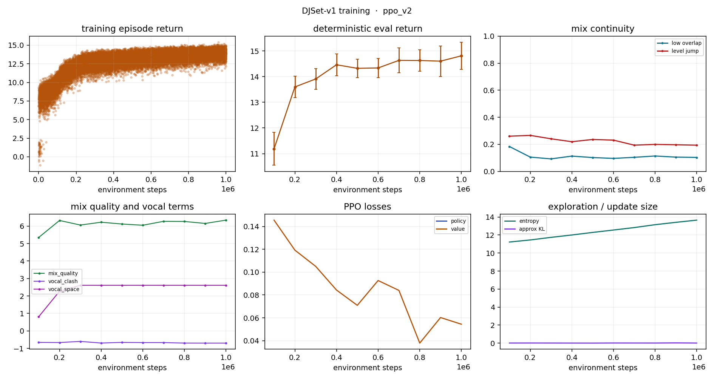

# Training run: ppo_v2

- data: `crate`
- episodes logged: 31264
- elapsed: 937.3 s

## Latest deterministic eval

| metric | value |
|---|---|
| timestep | 1000000.0000 |
| mean_return | 14.8105 |
| std_return | 0.5265 |
| final_fader | 1.0000 |
| low_overlap | 0.1038 |
| level_jump | 0.1940 |
| component_mix_quality | 6.3408 |
| component_vocal_clash | -0.6993 |
| component_vocal_space | 2.6100 |

