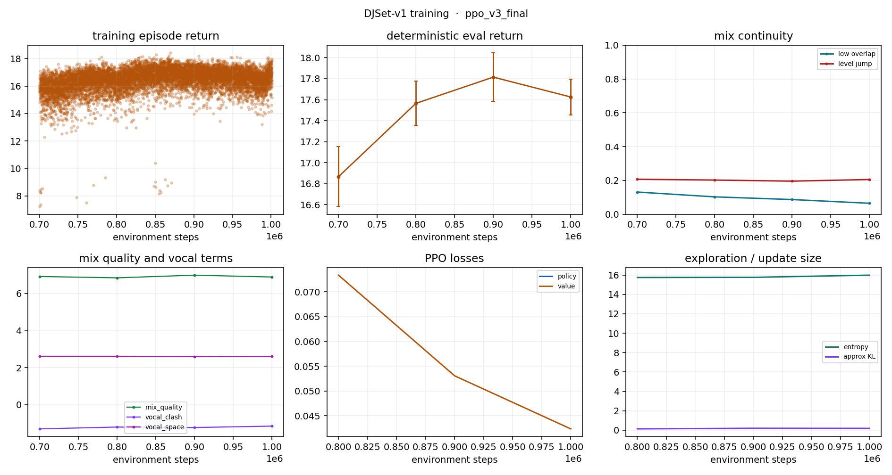

# Training run: ppo_v3_final

- data: `crate`
- episodes logged: 9408
- elapsed: 314.5 s

## Latest deterministic eval

| metric | value |
|---|---|
| timestep | 1000000.0000 |
| mean_return | 17.6256 |
| std_return | 0.1718 |
| final_fader | 1.0000 |
| low_overlap | 0.0652 |
| level_jump | 0.2058 |
| component_mix_quality | 6.8946 |
| component_vocal_clash | -1.1637 |
| component_vocal_space | 2.6000 |

