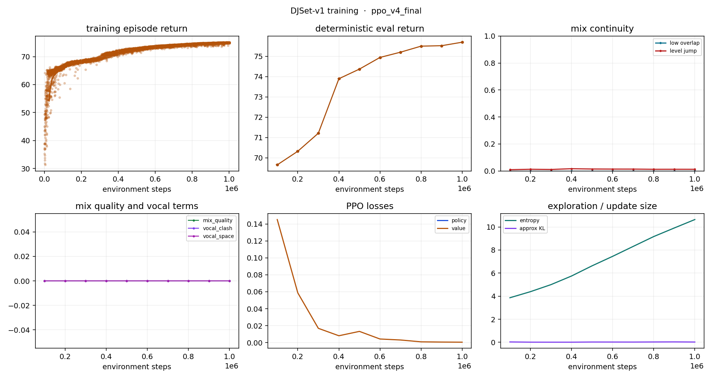

# Training run: ppo_v4_final

- data: `None`
- episodes logged: 7824
- elapsed: 680.8 s

## Latest deterministic eval

| metric | value |
|---|---|
| timestep | 1000000.0000 |
| mean_return | 75.6966 |
| std_return | 0.0000 |
| final_fader | 1.0000 |
| low_overlap | 0.0000 |
| level_jump | 0.0126 |

